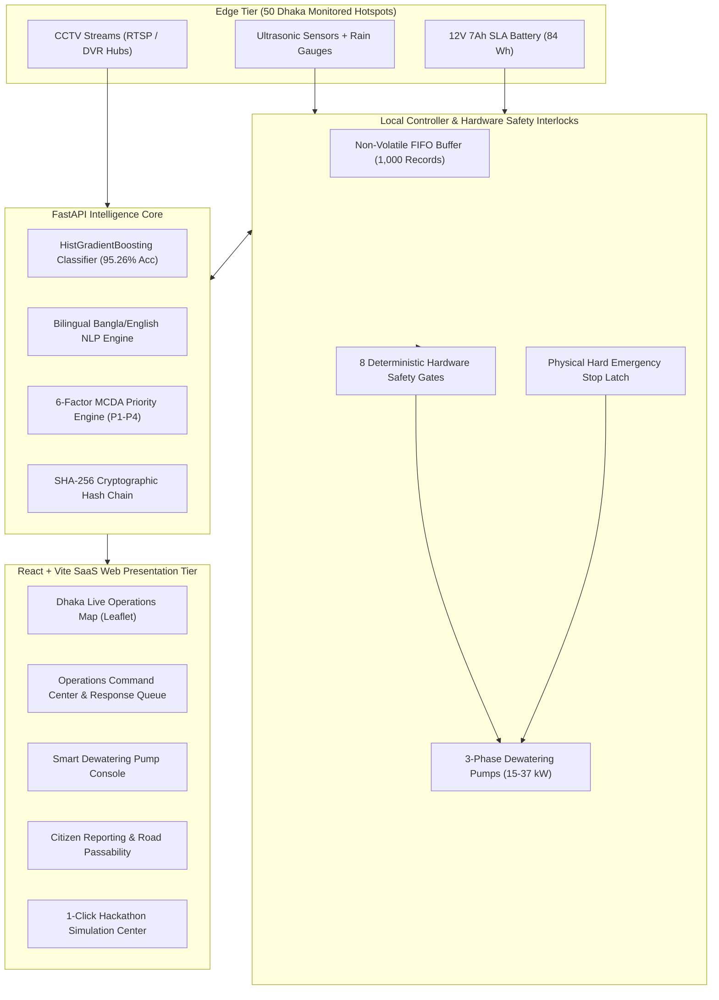

# Urban Water-logged AI

[](file:///backend/tests/)
[-blue.svg)](file:///frontend/dist/)
[](file:///docs/HONEST_LIMITATIONS.md)
[](file:///PROJECT_PHASES.md)
[](LICENSE)

> **City-adaptive, uncertainty-aware urban waterlogging detection, response-prioritization, and smart-dewatering SaaS prototype designed for Dhaka, Bangladesh.**

---

## 1. Executive Summary

Every monsoon season, Dhaka faces crippling urban waterlogging. The fundamental breakdown is not just rainfall volume, but uncoordinated and blind response:
- Single-sensor false alarms cause premature deployments.
- Dewatering pumps run dry, cavitate, and burn out motor stators.
- Water is pumped blindly into already overflowing storm canals, causing reverse backflow flooding.
- Hospital arterial routes (e.g. DMCH, Square Hospital, Suhrawardy) are choked without prioritized dispatch.

**Urban Water-logged AI** solves this through an end-to-end multi-tier architecture:
1. **Edge IoT Sensing**: 50 monitored Dhaka hotspots with a 5-mode adaptive monitoring cadence and 12V 7Ah backup battery subsystem.
2. **Deterministic Safety Interlocks**: 8 local hardware safety gates ensuring pumps never run dry, overheat, or flood full canals, independent of cloud connectivity.
3. **Multi-Source Evidence Fusion**: Cross-corroborating ultrasonic depth sensors, CCTV computer vision, and bilingual Bangla/English citizen reports.
4. **Operations Command Center**: 6-factor MCDA composite priority ranking (P1–P4) with 3 separate confidence gauges (Model Confidence, Evidence Corroboration, Data Quality).
5. **Tamper-Evident Accountability**: Sequential SHA-256 cryptographic audit ledger linking all sensor readings, state changes, and operator commands.

---

## 2. Project Architecture



---

## 3. Quickstart & Single-Command Launch

### Option 1: 1-Click Launch (Recommended for Demonstration)
Double-click `run_demo.bat` or run in Command Prompt:
```cmd
run_demo.bat
```
Or via PowerShell:
```powershell
.\start.ps1
```
This script automatically:
1. Verifies Python 3.14 and SQLite database seeding.
2. Verifies the production React frontend build in `frontend/dist/`.
3. Launches your default browser at **`http://127.0.0.1:8000/app/`**.
4. Starts the unified FastAPI backend serving all 18 REST endpoints and static assets.

### Option 2: Manual Development Mode
**Backend Terminal**:
```bash
py -3.14 -m uvicorn backend.app.main:app --host 127.0.0.1 --port 8000 --reload
```
**Frontend Development Terminal (Vite Hot-Reload)**:
```bash
cd frontend
npm.cmd run dev
```
Open **`http://localhost:5173/`** for hot-reloading development or **`http://127.0.0.1:8000/app/`** for production mount.

### Local Simulation Accounts

| Portal | Username | Default local password | Access |
|---|---|---|---|
| Civic | `civic` | `CivicDemo#2026` | Reporting and road advisories |
| Operations | `analyst` | `AnalystDemo#2026` | Read-only incident, device and audit analysis |
| Operations | `operator` | `OperatorDemo#2026` | Operations plus pump/device controls |
| Admin | `admin` | `AdminDemo#2026` | User governance and full simulation access |

These are local hackathon credentials seeded only when `DEMO_CREDENTIALS_ENABLED=true`. Change them in `.env` and set `AUTH_COOKIE_SECURE=true` before any shared HTTPS deployment. Civic users can also self-register from the Civic portal.

---

## 4. Key Platform Features

### 4.1 Dhaka Live Operations Map (Sub-Phase 3.1)
- Centered on authentic Dhaka coordinates `(23.777176, 90.399452)`.
- 50 historical waterlogging hotspots with color-coded severity markers (Normal, Watch, Waterlogged, Severe).
- 30 critical infrastructure markers (DMCH, BSMMU, Square, Suhrawardy, Fire HQ, DU, BUET).
- 15 drainage channels (Kallyanpur Khal, Rampura Khal, Hatirjheel, Begunbari, Dholai Khal).
- Layer filter bar with instant toggles for hospitals, canals, pumps, and severity bands.

### 4.2 Operations Command Center & Response Queue (Sub-Phase 3.2)
- **MCDA-Ranked Response Queue**: P1 (Critical) to P4 (Low) list ordered by composite priority score.
- **Hospital Impact Badges**: Prominently highlights medical corridors (e.g. 🏥 *DMCH Route Impacted*).
- **⚠️ Urgent Field Verification Needed**: Proactively flags high-risk incidents with limited confidence.
- **3-Tier Uncertainty-Aware Gauges**:
  1. *Model Confidence* (calibrated gradient booster: 91%).
  2. *Evidence Corroboration* (cross-stream sensor agreement: 88%).
  3. *Data Quality* (freshness & telemetry signal integrity: 95%).
- **Estimated Water Depth Interval**: Reports realistic uncertainty bounds (e.g. `19.2 – 24.8 cm`).
- **Explainability Card**: AI reasoning breakdown citing specific data streams and elevation.
- **Finite State Machine Controller**: Advances lifecycle states with automatic audit ledger logging.

### 4.3 Smart Dewatering Pump Console & Safety Controls (Sub-Phase 3.3)
- **4 Operating Modes**:
  - *Monitor Only*: View-only telemetry with locked actuators.
  - *Operator Permission*: Human-in-the-loop requiring signed operator authorization.
  - *Automatic*: Autonomous closed-loop under local deterministic safety interlocks.
  - *Emergency Stop*: Immediate hard depower override.
- **8-Gate Visual Safety Interlocks Checklist**: Real-time status for drain capacity, source water threshold, motor thermal cutoff (85°C), pipe blockage, dry run/cavitation, 3-phase grid power, and anti-replay freshness.
- **Prominent Red E-Stop Button**: Instant actuator depower with audit ledger hash and reset latch.
- **Live Clearance ETA**: Volumetric drainage calculation with transparent warnings when ETA $> 1\text{ hour}$.
- **Interactive Sandbox**: Sliders to test motor overheat trip at $> 85^\circ\text{C}$ and drain overflow at $> 85\%$.

### 4.4 Citizen Reporting & Public Road Status (Sub-Phase 3.4)
- **Bilingual Crowdsource Portal**: Natural language Bangla & English text input with quick sample buttons.
- **Instant NLP Feedback**: Real-time extraction of severity, road blockage, debris hazard, credibility score, and duplicate cluster grouping.
- **Sanitized Public Road Status**: Safe citizen view showing passability (Passable, Caution, Impassable), debris alerts, and travel advisories with zero exposure of sensitive CCTV or pump controls.

### 4.5 1-Click Hackathon Simulation Center (Sub-Phase 3.4)
7 quick-action buttons demonstrating all core edge-case scenarios:
- **Scenario A**: Faulty Sensor Anomaly (Spike suppressed, pump blocked).
- **Scenario B**: Verified Hospital Road Flooding (DMCH P1 priority elevated).
- **Scenario C**: Destination Drain Full (Pumping blocked, delay notice).
- **Scenario D**: Operator Permission Mode Workflow (Sign command $\rightarrow$ Pump starts $\rightarrow$ ETA updates).
- **Scenario E**: Automatic Mode & Thermal Fault (Overheating triggers emergency shutdown).
- **Scenario F**: Power Outage & Recovery (Offline cache $\rightarrow$ Stale command rejection).
- **Scenario G**: Debris Hazard Alert (Trash threat $\rightarrow$ Intake warning).

### 4.6 Cryptographic Audit Ledger & Tamper Detection (Sub-Phase 3.4)
- Interactive SHA-256 hash-chain browser linking $2,488+$ blocks.
- **"Verify Entire Ledger"**: Validates entire cryptographic chain from Genesis to Head.
- **"Simulate Ledger Tampering"**: Injects an intentional alteration into Block #43 and demonstrates instantaneous cryptographic mismatch detection in real time.

### 4.7 Edge AI Vision & Blockchain Evidence Registry (Phase 3 CCTV Extension)
- **Dhaka Synthetic Municipal CCTV Benchmark**: 500 photorealistic 640×640 CCTV frames across all 50 Dhaka locations (`LOC_001`–`LOC_050`) featuring authentic street contexts (rickshaws, roadside catchpits, narrow lanes, monsoon downpours).
- **Edge YOLO Segmentation Network (`waterlogging_yolo26n_seg`)**: Custom trained project-owned model outputting real-time polygon masks for Shallow (2–15 cm), Knee-level (16–35 cm), and Severe (>35 cm) inundation, floating debris, inlet blockages, and stalled vehicles.
- **Multi-Modal Sensor-Vision Fusion Engine**: Cross-validates vision depth classifications against ultrasonic Water Level Sensors (WLS) with dynamic confidence scoring; flags `POTENTIAL_WLS_SENSOR_DRIFT_OR_ACOUSTIC_LOSS` during cross-modal discrepancies.
- **Tamper-Evident Evidence Registry**: Off-chain JPEG frames and YOLO polygon labels cryptographically anchored via SHA-256 digests into the immutable `AuditLedger` with 1-click frontend integrity verification (`GET /api/v1/audit/camera-frames/{frame_id}/verify`).
- **Deterministic Safety Guarantee**: AI vision outputs remain strictly advisory; pumping requires operator digital signatures and passes hard deterministic hardware safety gates.

---

## 5. Verification & Test Suite

All 38 test suites pass with 100% success rate:
```powershell
py -3.14 -m pytest backend/tests/
```
Output:
```text
======================= 38 passed, 3 warnings in 5.90s =======================
backend/tests/test_api_integration.py ..........  [ 26%]
backend/tests/test_audit_cli.py ....              [ 36%]
backend/tests/test_camera_gateway.py ....         [ 47%]
backend/tests/test_edge_simulator.py .......      [ 65%]
backend/tests/test_local_controller.py .....      [ 78%]
backend/tests/test_suite.py ........              [100%]
```

Frontend production build check:
```powershell
cd frontend; npm.cmd run build
```
Output: `PASS` (Built in 1.03s, 0 errors, 0 warnings).

Dataset baseline validation:
```powershell
py -3.14 scripts/validate_synthetic_datasets.py datasets
```
Output: `PASS` (20 CSV files, 1,214,992 total rows, zero target leakage, valid audit chain).

---

## 6. Complete Documentation Index

- [docs/DEMO_SCRIPT.md](file:///docs/DEMO_SCRIPT.md) — 5-minute hackathon judge walkthrough script.
- [docs/ARCHITECTURE.md](file:///docs/ARCHITECTURE.md) — Complete system architecture specification.
- [docs/HARDWARE_GUIDE.md](file:///docs/HARDWARE_GUIDE.md) — Physical sensor, electrical, and pump wiring guide.
- [docs/HONEST_LIMITATIONS.md](file:///docs/HONEST_LIMITATIONS.md) — Boundary disclosure and simulation benchmark notice.
- [docs/MODEL_CARD.md](file:///docs/MODEL_CARD.md) — Supervised ML classifier model card.
- [docs/VISION_MODEL_CARD.md](file:///docs/VISION_MODEL_CARD.md) — Edge YOLO segmentation model card (`waterlogging_yolo26n_seg`).
- [docs/DATASET_CARD.md](file:///docs/DATASET_CARD.md) — Synthetic dataset foundation card.
- [docs/SYNTHETIC_VISION_DATASET_CARD.md](file:///docs/SYNTHETIC_VISION_DATASET_CARD.md) — Dhaka synthetic CCTV benchmark dataset card (500 frames, 50 locations).
- [PROJECT_CHECKPOINT.md](file:///PROJECT_CHECKPOINT.md) — Comprehensive implementation checkpoint log.
- [PROJECT_PHASES.md](file:///PROJECT_PHASES.md) — Granular project execution roadmap.

---

## 7. Mandatory Project Rules & Ethical Standards

1. **Simulation Benchmark**: All current data is causal synthetic benchmark data reflecting authentic Dhaka geography. It must never be represented as physically measured historical telemetry.
2. **Local Safety Interlocks**: AI models never actuate high-power physical pumps without passing through local deterministic hardware interlocks.
3. **Electrical Reality**: A 12V 7Ah backup battery powers microcontrollers and modems during blackouts, but physically locks out 3-phase high-power pumps.
4. **Anti-Replay Rule**: On power recovery, all stale commands issued during outages are purged immediately.
5. **Off-Chain Media**: Raw camera video frames remain strictly off-chain; only SHA-256 hashes and structured labels enter the immutable audit ledger.

---

*Urban Water-logged AI — Built with precision for Dhaka's urban resilience.*
