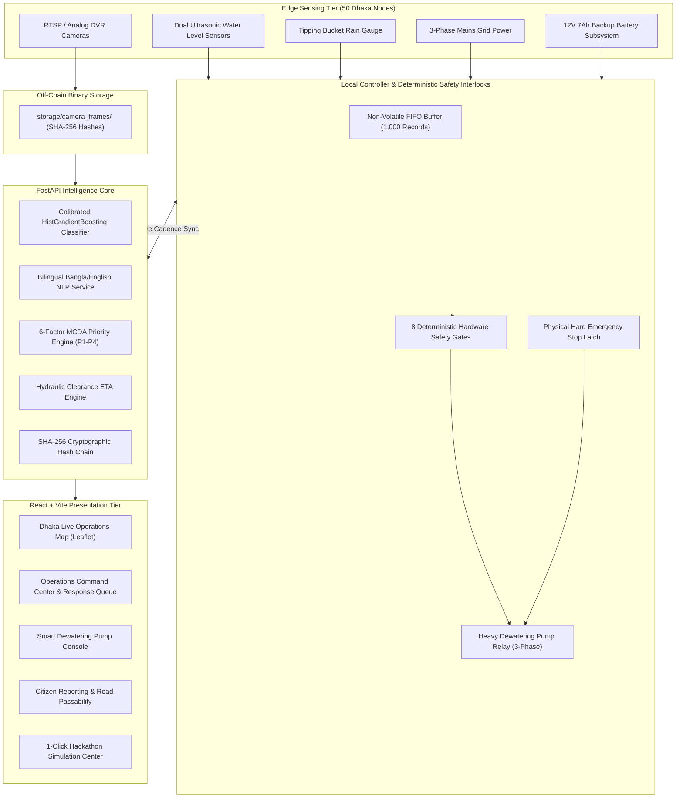

# Urban Water-logged AI — System Architecture Specification

## 1. Architectural Overview

Urban Water-logged AI is designed as a city-scale, uncertainty-aware urban waterlogging detection, response prioritization, and smart-dewatering SaaS prototype tailored for the megacity of Dhaka, Bangladesh. The architecture enforces strict separation between cloud machine learning, deterministic local safety controls, off-chain media storage, and tamper-evident cryptographic auditing.

---

## 2. Tier-by-Tier Architecture

### 2.1 Edge Sensing & Power Tier
- **50 Monitored Dhaka Locations**: Covers historical high-risk waterlogging zones across North and South Dhaka City Corporations (DNCC & DSCC), including Mirpur-10, Kazipara, Green Road, Dhanmondi 27, Panthapath, Karwan Bazar, Farmgate, Mohakhali, Banani, and Old Dhaka.
- **5-Mode Adaptive Telemetry Cadence**:
  - *Normal Mode* (10 min): Standard baseline dry weather polling.
  - *Watch Mode* (5 min): Early warning precipitation or forecast rainfall risk.
  - *Alert Mode* (45 sec): Rapid water rise or depth $\ge 15\text{ cm}$.
  - *Pumping Mode* (2s local safety polling, 15s cloud sync): Active dewatering operation.
  - *Recovery Mode* (2 min): Water receding post-pumping; verifying road opening.
- **Electrical Power Constraint**:
  - IoT edge microcontrollers, sensors, and 4G radios are equipped with a **12V 7Ah sealed backup battery** (84 Wh total capacity).
  - **CRITICAL HARDWARE RULE**: The backup battery **NEVER** powers high-power 3-phase dewatering pumps ($15\text{ kW}$ to $45\text{ kW}$). During a mains grid blackout, the pump actuator is physically locked out, and the edge controller operates in low-power monitoring mode.

---

### 2.2 Local Controller & Safety Interlock Tier
- **Deterministic Hardware Safety Gates**: Pumping requires unanimous passage of 8 deterministic criteria:
  1. *Emergency Stop Inactive*: No active manual E-Stop condition.
  2. *Mains Power Availability*: 3-phase grid power active (backup battery lockout enforced).
  3. *Sensor Validity*: Unphysical reading spikes suppressed as anomalies.
  4. *Source Water Depth*: Depth $\ge 10.0\text{ cm}$ (minimum activation threshold).
  5. *Destination Drain Headroom*: Destination storm canal level $\le 85\%$ full (prevents reverse canal flooding).
  6. *Discharge Pipe Clearance*: No pipe blockage or excessive back-pressure.
  7. *Dry-Run Protection*: Intake submerged; zero cavitation risk.
  8. *Motor Thermal Safety Limit*: Motor temperature $\le 85.0^\circ\text{C}$.
- **Non-Volatile Offline FIFO Buffer**: When cellular/network connectivity drops, edge controllers buffer up to 1,000 telemetry readings locally.
- **Anti-Replay Stale Command Purge**: On power recovery or network reconnection, all queued or stale actuation commands issued during the blackout are immediately purged. A fresh deterministic safety re-check is mandated before any pump can start.

---

### 2.3 Off-Chain Camera Media & Privacy Tier
- **Off-Chain Media Storage**: Raw camera frames and video clips are stored in a dedicated off-chain directory (`storage/camera_frames/`).
- **Cryptographic Digest Linkage**: Only SHA-256 binary digests (e.g. `e3b0c44298fc1c149afbf4c8996fb92427ae41e4649b934ca495991b7852b855`) and structured CV metadata (coarse depth bands: `none`, `shallow`, `moderate`, `deep`; debris present: boolean; obstruction ratio) are transmitted to the cloud and entered into the audit ledger.
- **Citizen Privacy Protection**: Private CCTV feeds and facial/license plate telemetry are strictly isolated from the public advisory interface.

---

### 2.4 Intelligence & Analytical Core Tier
- **Supervised ML Severity Classifier**: Calibrated `HistGradientBoostingClassifier` trained on 239,680 records and tested on 100,800 records. Produces probability distributions across `Normal`, `Watch`, `Waterlogged`, and `Severe`.
- **Multilingual Bangla/English NLP**: Real-time rule-assisted keyword and sentiment analyzer for citizen crowdsource reports, extracting severity, road blockage, critical infrastructure impact, debris presence, and credibility score.
- **6-Factor MCDA Priority Engine**: Computes composite priority scores (0.0 to 1.0) and assigns response classes:
  - **P1 (Critical)**: High flood depth directly obstructing primary arterial access to critical healthcare assets (DMCH, Square, Suhrawardy).
  - **P2 (High)**: Major arterial flooding, secondary medical corridors, and high population impact.
  - **P3 (Medium)**: Moderate residential waterlogging with available alternate bypass routes.
  - **P4 (Low)**: Minor water accumulation ($< 10\text{ cm}$) resolving via natural drainage.
- **3-Tier Uncertainty-Aware Gauges**:
  - *Model Confidence*: Calibrated classifier certainty.
  - *Evidence Corroboration*: Sensor, CCTV, and citizen cross-stream agreement.
  - *Data Quality*: Telemetry freshness and signal completeness.
- **Clearance ETA Engine**: Calculates volumetric drainage duration range (e.g. "25–40 minutes") and issues transparent notices when ETA exceeds 1 hour or drainage canals are restricted.

---

### 2.5 Tamper-Evident Cryptographic Ledger Tier
- **Sequential SHA-256 Hash Chain**: Each audit record links to the previous block hash:
  $$\text{Current Hash} = \text{SHA256}(\text{Index} \parallel \text{Incident ID} \parallel \text{Timestamp} \parallel \text{Event Type} \parallel \text{Actor} \parallel \text{Payload JSON} \parallel \text{Previous Hash})$$
- **Dual-Source Verification**: Verified both via standalone CLI (`scripts/verify_audit_ledger.py`) and browser UI (`AuditLedgerVerifier.tsx`).
- **Instant Tamper Detection**: Any retroactive modification of record contents or broken block pointers is flagged immediately with the exact corrupted block ID.

---

### 2.6 Presentation & Web SaaS Tier
- **React + Vite + TypeScript**: Modular single-page application mounted directly onto FastAPI at `/app` (single-command deployment).
- **Dhaka Live Map**: Interactive Leaflet engine with 50 color-coded severity hotspots, 30 critical infrastructure markers, 15 drainage channels, and layer filter toggles.
- **Operations Command Center**: MCDA-ranked response queue with hospital route impact badges and urgent field verification flags.
- **Smart Dewatering Pump Console**: Cockpit with 4 operating modes, 8-gate safety checklist, clearance ETA display, red Emergency Stop button, and live interactive slider sandbox.
- **Citizen & Simulation Portal**: Bilingual citizen reporting with instant NLP classification feedback, sanitized public road passability advisories, and 7 one-click hackathon simulation scenario buttons.
