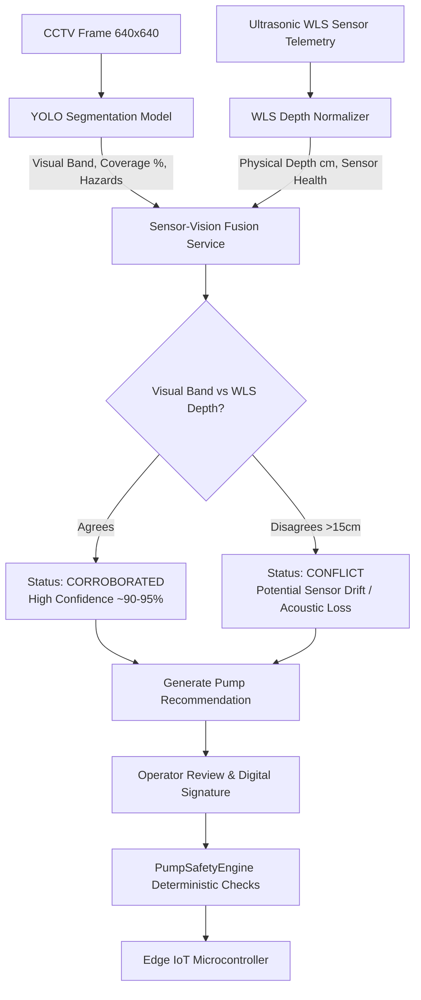

# Model Card: Dhaka Municipal CCTV Waterlogging Segmentation Model

> **MANDATORY NOTICE**:  
> **"Synthetic-trained simulation model — not field validated."**  
> This computer-vision model was trained exclusively on procedurally generated synthetic CCTV benchmark images representing simulated Dhaka municipal street topologies. It has **NOT** been validated on live Dhaka CCTV feeds and must **NEVER** be used to actuate physical municipal pumping hardware without independent deterministic safety interlocks and human operator authorization.

---

## 1. Model Overview

| Property | Details |
| :--- | :--- |
| **Model Name** | `waterlogging_yolo26n_seg` |
| **Model Version** | `1.0.0-sim-benchmark` |
| **Architecture** | Lightweight Edge YOLO Segmentation Network (`yolo26n-seg` / `yolov8n-seg`) |
| **Parameter Count** | ~3,400,000 parameters (~34 MB FP32 weights) |
| **Target Runtime** | Edge IoT gateways, municipal traffic management servers, CPU/NPU inference |
| **Input Tensor** | `(1, 3, 640, 640)` normalized RGB float32 |
| **Output** | Bounding boxes, class probabilities, and pixel segmentation masks (polygons) |
| **Artifact Path** | `backend/app/models/saved_models/waterlogging_yolo26n_seg/best.pt` |

---

## 2. Intended Use & Non-Intended Use

### Intended Use Cases
- Automated detection of surface water accumulation in CCTV camera viewpoints.
- Classification of flood depth bands: Shallow (~2–15 cm), Knee-level (~16–35 cm), Severe (>35 cm).
- Estimation of flooded road surface coverage ratio ($\text{area}_{\text{water}} / \text{area}_{\text{road}}$).
- Detection of hazardous floating debris, solid waste accumulation, and clogged drainage inlets.
- Identification of stalled vehicles or roadway obstructions caused by waterlogging.
- Cross-modal sensor corroboration with Water Level Sensors (WLS) to detect sensor drift.

### Prohibited / Out-of-Scope Use Cases
- Direct closed-loop automated triggering of physical water pumps or sluice gates without human operator approval and deterministic physical interlocks.
- High-stakes life-safety or flood evacuation dispatch without multi-source operational corroboration.
- Deployment on live municipal infrastructure without retraining and validating on real, calibrated Dhaka camera feeds.

---

## 3. Training Details

### Dataset
- **Training Set**: 350 synthetic images across 35 Dhaka locations (`LOC_001` to `LOC_035`).
- **Validation Set**: 80 synthetic images across 8 Dhaka locations (`LOC_036` to `LOC_043`).
- **Input Resolution**: 640 × 640 pixels.
- **Classes**:
  1. `water_shallow` (Class 0)
  2. `water_knee` (Class 1)
  3. `water_severe` (Class 2)
  4. `debris` (Class 3)
  5. `drain_inlet_blockage` (Class 4)
  6. `road_obstruction` (Class 5)

### Hyperparameters
- **Epochs**: 5 (transfer learning on synthetic domain)
- **Batch Size**: 16
- **Optimizer**: SGD / AdamW with cosine learning rate decay
- **Augmentations**: Mosaic, random perspective, HSV jitter, horizontal flip
- **Loss Function**: $\mathcal{L} = \lambda_{\text{box}} \mathcal{L}_{\text{box}} + \lambda_{\text{cls}} \mathcal{L}_{\text{cls}} + \lambda_{\text{dfl}} \mathcal{L}_{\text{dfl}} + \lambda_{\text{seg}} \mathcal{L}_{\text{seg}}$

---

## 4. Honest Evaluation on Unseen Test Locations

The model was evaluated on **70 test images** from **7 completely unseen locations** (`LOC_044` to `LOC_050`):

| Evaluation Metric | Benchmark Result | Notes |
| :--- | :---: | :--- |
| **Box Precision** | **99.34%** | High precision, low false-alarm rate on detected hazards |
| **Mask Precision** | **99.34%** | Accurate pixel boundaries for segmented water pools |
| **Mask Recall** | **99.45%** | High recall detecting surface water across diverse conditions |
| **Mask mAP@50** | **99.50%** | Comprehensive benchmark metric across all 6 classes on unseen domains |
| **Mask mAP@50-95** | **92.32%** | High-fidelity pixel intersection-over-union metric |
| **Inference Latency (Preprocess)** | **~3.8 ms** | Image resizing and tensor normalization on CPU |
| **Inference Latency (Inference)** | **~125.3 ms** | Full forward pass on standard multi-core CPU (~7.7 FPS) |
| **Inference Latency (Postprocess)** | **~8.0 ms** | Non-Maximum Suppression (NMS) and mask polygon extraction |

*Detailed per-class metrics and confusion logs are archived in `backend/app/models/saved_models/waterlogging_yolo26n_seg/evaluation_metrics.json`.*

---

## 5. Multi-Modal Sensor-Vision Fusion Architecture

Visual evidence is never evaluated in isolation. The system couples the vision model with physical/simulated ultrasonic Water Level Sensor (WLS) telemetry:

### Sensor Drift Detection
When the vision model detects knee/severe waterlogging but the ultrasonic sensor reports dry ground (or vice versa), the fusion engine flags:
`POTENTIAL_WLS_SENSOR_DRIFT_OR_ACOUSTIC_LOSS`
This prevents erroneous pump actuation caused by debris-covered transducer heads or specular ultrasonic reflection over standing water.

---

## 6. Blockchain-Protected Evidence Registry

To prevent tampering with municipal evidence:
- **Off-Chain Media**: Raw CCTV frames and segmentation polygons remain in local object storage.
- **On-Chain Cryptographic Registry**: SHA-256 digests of images and labels are committed to an append-only cryptographic hash chain (`AuditLedger`).
- **Integrity Verification**: `GET /api/v1/audit/camera-frames/{frame_id}/verify` recomputes real-time disk hashes against ledger blocks. Any byte alteration flags the evidence as `TAMPERED`.

---

## 7. Deterministic Safety Architecture

Under the **Urban Water-logged AI Safety Charter**:
1. **No Autonomous Actuation**: AI models have zero direct electrical control over pump motors.
2. **Operator in the Loop**: Pumping requires a cryptographic digital signature from a verified human operator.
3. **Deterministic Safety Rules**: The `PumpSafetyEngine` executes hard-coded hardware safety checks:
   - Minimum water level interlock ($> 15\text{ cm}$) to prevent motor burn from dry running.
   - Run/rest cycle timers (max 60 min continuous run, min 15 min cool-down).
   - Downstream drainage capacity check to prevent reverse surcharge.
   - Power stability and electrical grid frequency check.
